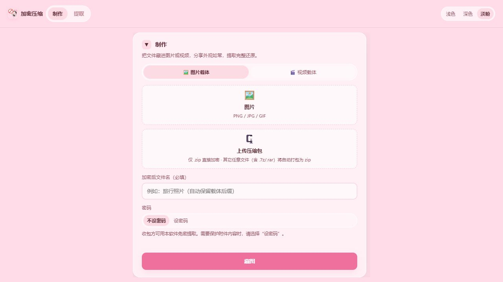

# 加密压缩 · ImgPkg

把附件加密后藏进图片或视频，用一份文件分享，也用同一个工具完整取回。

一款面向 Windows 的本地桌面工具，支持图片／视频载体、自动打包、自定义或随机密码，以及淡粉、浅色、深色三套主题。制作与提取在本机完成，无需注册账号。

**[下载 Windows 便携版](https://github.com/qcya/imgpkg-tool/releases/latest) · [查看 v1.1.2 更新](https://github.com/qcya/imgpkg-tool/releases/tag/v1.1.2)**



## 下载与运行

打开 [Releases](https://github.com/qcya/imgpkg-tool/releases)，下载 `ImgPkg-Portable-1.1.2-Windows-x64.exe`，双击运行，无需安装。当前提供 Windows x64 便携程序；GitHub 自动生成的 Source code 是源码，不是可直接运行的软件。

## 可以做什么

- **以图片或视频为载体**：支持 PNG、JPG、GIF，以及 MP4、MOV、AVI、MKV、WEBM、3GP。直接保留载体字节，不重新编码；视频能否预览取决于播放环境对编码的支持。
- **放入任意单个文件**：ZIP 可直接封装；其他文件（包括 7z、RAR）自动打包成 ZIP。提取自动打包的单文件时，直接还原原文件。
- **选择密码方式**：不设密码时通过软件免密提取；设密码时支持自定义密码或生成随机密码。
- **本地加解密**：使用 AES-256-GCM、PBKDF2 和分块处理，在 Worker 中执行加解密，并显示处理进度。
- **保留使用习惯**：制作、提取两种模式；淡粉、浅色、深色主题；支持拖拽上传和键盘操作。

## 怎么使用

### 制作

1. 在“制作”中选择图片或视频载体。
2. 上传要放入的附件，普通文件会自动打包。
3. 填写输出文件名，建议不填写后缀，让软件自动保留载体后缀。
4. 按需要选择免密、自定义密码或自动生成密码。
5. 点击“藏图”或“藏视频”，下载生成的文件。使用随机密码时，请同时保存密码。

### 提取

1. 切换到“提取”，选择收到的文件。
2. 如果文件设置了密码，输入发件人提供的密码。
3. 点击“提取”，下载还原后的文件或压缩包。

为兼容旧版输出及分享过程中改名的文件，提取根据文件内容识别附件，不依赖扩展名。

## 关于保护与分享

本工具通过**在载体末尾追加附件容器**保存数据，不是像素隐写，也不保证别人无法发现其中有附加数据。仅修改后缀不能直接解开本工具加密的附件。

不设密码模式使用软件内置密钥封装，任何拿到文件并使用本工具的人都可以提取。需要限制访问时，请设置密码，并妥善保存；软件没有密码找回功能。

分享时请发送**原文件**。社交平台的图片压缩、视频转码，以及图片编辑器重新导出，可能删除尾部附件。重要内容建议另留原始备份。

当前实现会把文件读入内存，单个载体和附件各有约 1.5 GiB 的输入限制，实际可处理大小还取决于可用内存。它不适合作为超大文件流式加密工具。

## v1.1.2 更新

- 统一间距、字号和盒模型，修复输入框溢出、上传区裁切和小窗口布局。
- 完整比例预览图片，移除视频时停止播放并释放预览资源。
- 上传支持 Enter／空格，提取密码支持 Enter 提交；处理期间展示进度并避免重复操作。
- 为 Worker 增加任务编号，隔离并发结果；在线程异常或终止时结束等待任务。
- 兼容旧版容器格式及任意输出后缀，保留三套主要配色与制作／提取用途。
- 增加 6 项核心回归测试，覆盖并发、密码／免密提取、旧格式、线程恢复与分块防篡改。

## 本地开发

技术栈：Electron、TypeScript、Vite、fflate。建议使用 Node.js 20 或更新版本。

```bash
npm ci
npm run dev           # 浏览器界面调试
npm run electron:dev  # Electron 桌面调试
npm test              # 核心回归测试
npm run build         # 类型检查与生产构建
```

在 Windows 上从新克隆的源码构建便携程序：

```bash
npm ci
npm run build
npx electron-builder --win portable --config.electronDist=node_modules/electron/dist
```

程序输出到 `release/`。项目原有 `npm run dist:portable` 命令使用 `.cache/electron-dist` 中预先准备的 Electron 运行时，该缓存不纳入源码仓库。

## 源码结构

```text
src/
  main.ts           制作／提取界面与交互
  core/             附件容器、加解密编排与打包
  worker/           分块加解密 Worker 与任务管理
  ui/               界面工具、主题和文件上传
  styles/           三套主题与响应式布局
electron/           桌面窗口、预加载桥接与图标
tests/              核心回归测试
```

作者：B站青春沿岸 · [qcya](https://github.com/qcya)

许可证：[MIT](LICENSE)
